# Formal UI Evaluation & Architecture Plan — Claims × Contexts × Actions × Conclusions (`CC rc9` → `CSD/4` → `View-Forms`)

> **Purpose:**
> 1. Evaluate the current UI code across **CEWPOS** ([`view-forms-spike/`](view-forms-spike/), [`view-form-component/`](view-form-component/)) and **[`CIRISClient`](https://github.com/CIRISAI/CIRISClient)** against the stated end-to-end constitutional mesh goal, the **[Circles explainer](https://cirisai.github.io/CIRISClient/circles.html)** (`docs/circles.html`), and the **CSD/3 → CSD/4** specification standard.
> 2. Derive the **complete formal UI space** — **Claims ($\mathcal{C}$)**, **Contexts ($\mathcal{X}$)**, **Actions ($\mathcal{A}$)**, and **Conclusions ($\mathcal{V}$)** — that is maximally possible under the **[`CIRISConstitution` `rc9` formal-closure branch](https://github.com/CIRISAI/CIRISConstitution/tree/rc9)**.
> 3. Define the **Minimum Viable Reusable Component Basis** (12 formal primitives) and the **Typed Epistemic Scene IR** that allow every CSD surface to be built as a pure, zero-import WASM view-form over the normalized mesh state vector, exposing the structural truths of the cleanest possible UI.

---

## Part I — Evaluation of Current UI Code Against the Constitutional Mesh Goal, `circles.html`, and `CSD/3 → CSD/4`

### 1.1 Evaluation of CEWPOS's Current UI Code (`view-forms-spike/` & `view-form-component/`)

| File / Module | What It Proves Today | Gap Against the Constitutional Mesh & `CSD/4` |
|---|---|---|
| [`view-forms-spike/src/scene.rs`](view-forms-spike/src/scene.rs) | Defines a pure, Bevy-free `Scene` IR (`Vec<SceneNode>`, `Camera`, `background`) with a closed 3-mesh enum (`MeshKind::Sphere \| Cube \| Plane`). Compiles cleanly to `wasm32-unknown-unknown`. | **Geometry-only IR, not an Epistemic UI IR.** It can draw a 3D score sphere, but has no representation of the 5-fact Receipt (`CSD-006`), the 5 Circles (`CohortScope`), the 7 list states (`StateBlock`), the 3-fact `ConfirmSheet`, or the `TwoPath` governance ceremony. |
| [`view-forms-spike/src/view_form.rs`](view-forms-spike/src/view_form.rs) | Implements `view_form(&Form) -> Scene`: maps `Op::Scores` (`score` $\in [-1, 1] \to$ red/green color; `confidence` $\in [0, 1] \to$ scale; `dimension` $\to$ label) and maps the 4 composer operators (`delegates_to`, `supersedes`, `withdraws`, `recants`) to a neutral grey sphere. | **Single-row inspector, no state-vector fold.** It inspects one isolated `Form` at a time rather than folding the `rc9` plane state (`STATE_TABLE.tsv`) or rendering the relationship between a claim, its contest/withdrawal chain, its holders, and the viewer's policy lens. |
| [`view-form-component/host/src/main.rs`](view-form-component/host/src/main.rs) | Instantiates a WIT-typed WASM component against an empty `Linker<()>` (0 host imports) and proves that a malicious component demanding a host capability fails at instantiation. | **One-way render only (`render(json) -> scene`).** Does not yet close the loop on *user interaction*: how a click on an action in the rendered scene emits a typed `Intent` back to the host's `ConfirmSheet` / 1-step admission gate without granting ambient authority to the guest WASM component. |
| [`view-forms-spike/src/bin/render.rs`](view-forms-spike/src/bin/render.rs) | Drives headless Bevy 0.19 GPU rendering (`RenderTarget::Image` + `Readback`) to deterministic PNGs. | **No `CSD/3` / `CSD/4` test-tag tree export.** `CIRISClient`'s 5-platform harness drives surfaces via `/tree`, `/click`, `/input`, `/scroll`, and `csd:tests` checkpoints. CEWPOS's Scene IR needs deterministic `tag` + `automationText` projection so the exact same `CSD/4` flows can drive native Bevy/WASM view-forms. |

### 1.2 Evaluation of `CIRISClient` UI Code Against `circles.html` and `CC rc9`

`CIRISClient` (`ui/shell/CirclesShell.kt`, `ui/nav/CirclesNav.kt`, `ui/primitives/*.kt`) has already converged on a remarkably disciplined architecture that directly embodies the [Circles explainer](https://cirisai.github.io/CIRISClient/circles.html):

1. **What `CIRISClient` Gets Right (Architectural Truths Already Proven in Code):**
   - **The One Nav Tree (`CirclesNav.kt` + `CirclesShell.kt`):**
     - **5 Circles** (`CohortScope`: *Just me · Family · Neighbours · Communities & Businesses · Everyone*) in a fixed bottom bar (phone) or left rail ($\ge 900\text{dp}$), never reordered, never hidden.
     - **7 Tabs per Circle** (*Files · Chats · People · Safety · Rules · Decisions · Record*).
     - **2 Permanent Top-Bar Anchors:** *My things* (top-left signet opening the 6 non-circle Instruments: *Devices & keys, Everything I shared, This agent, This node, Someone I trust, Help*) and *Stop everything* (top-right emergency brake, always above the scroll).
     - **Runtime Narrowing (`hasAgent`):** The `This agent` and `Someone I trust` instruments and agent-only cards disappear cleanly when attached to a bare node (`CC 4.4.3.4.3` separation of `agency:*` vs. `infra:*`).
   - **The Hamburger Is the Epistemic Test (`ItemRow.kt` + `Receipt.kt` + `ReceiptSheet.kt`, `CSD-006`):**
     - A row on screen has a hamburger (`btn_receipt_<id>`) **if and only if** it came off the wire as a signed CEG claim. App chrome (*My things* rows, settings) has no receipt and therefore no hamburger.
     - Every receipt renders the **exact same 5 envelope facts** (`subject_key_ids`, `attesting_key_id`, `cohort_scope`, `dimension`, `consent:scope` + optional `for_key_id`), typing each fact as `Fact.Wire` (sent by node), `Fact.ByRule(ccRef)` (fixed by constitution), or `Fact.NotSent` (error tone — never guessed or hidden).
   - **Directional Asymmetry of Consent (`ConfirmSheet.kt`):**
     - *"Going out asks. Coming back never does."* (`circles.html` Scene 11 `Move`). `confirmFacts()` enforces at runtime (`require(facts.size == 3)`) that every outward/consequential confirmation names **exactly 3 facts** about what changes, plus an optional `note` in `Tone.DANGER` stating what the node *cannot* verify.
   - **Error Never Looks Like Empty (`StateBlock.kt`):**
     - Enforces a 7-way algebraic sum (`Populated | Loading | Empty | Error | FileGone | HiddenByRules | Unreviewed`) where `Error` (`Tone.DANGER`, bordered) and `Unreviewed` (`Tone.BRAND`, bordered, never green per CC Part 8) are visually and structurally disjoint from `Empty` (`Tone.MUTE`).

2. **Gaps Exposed When Cross-Examined Against `circles.html` and `CC rc9` (`review/derivation/` & `formal/`):**
   - **Gap 1 — 14 Unserved Promise Sub-Rules (`review/derivation/csd_promise_notes.md`):**
     - Of the 46 sub-rules across the 11 Promises (`00_guarantees_plain.md`), **14 have no CSD card or UI surface yet** (and are reserved as `CSD-111`–`CSD-119`, `CSD-127`–`CSD-128` under `CIRISClient#179`):
       - **Steward–Agent Bond & Lifecycle (`Promise 3 & 5`):** `3a` Steward bond row with listed powers & 365-day review (`CSD-115`), `3e` Stewardship tier & creator's intent at onboarding (`CSD-115`), `5a/5b` Planned steward shutdown dialogue where the agent can accept/object/postpone on the record (`CSD-111`), `5d/5e` WA-gated identity-record edit and behavioural drift review (`CSD-112`), `5f` 7-state Retirement Standard floor (`CSD-113`), `5g` Upgrade offer with version/changelog/risk and recorded refusal (`CSD-114`).
       - **Guardian Bond & Protected Channels (`Promise 2 & 3`):** `2d` Protected reporter channel (`CSD-128`), `3c` Guardian bond with verified relationship, scheduled review, and child's confidential help/contest channel (`CSD-119`).
       - **Published Principles, Apophatic Bounds & First Contact (`Promise 6, 7, 8, 9`):** `6e` First-contact gate & one-step root exit (`CSD-127`), `7a/7b` Published principles & priority order (`CSD-116`), `8b/8c` WA rulings cadence & peer review (`CSD-117`), `9a/9c` Public `NEVER_ALLOWED` (`prohibited:*`) list and operator engagement-optimisation declaration (`CSD-118`).
   - **Gap 2 — `CeremonyBlock.kt` Is Single-Path (`signed / needed`), Whereas `CC rc9` Is Two-Path (`governance_policy.json`):**
     - `CeremonyBlock.kt` only models a simple $k$-of-$n$ counter (`SignerState.PROPOSED | SIGNED | NOT_YET`).
     - In `CC rc9`, `formal/two_path/TwoPath.tla` and `manifests/governance_policy.json` prove that CIRIS governance has **one universal decision machine** with **two landing paths** (*forward enact* at `enact_votes`, *reverse silence* at `window_secs` if $\ge$ `floor_votes`), an **objection brake** (`cancel_votes` over `base` or `others`), and an **irreversibility lock** (`irreversible: true` forbids instant forward landing).
     - Because `CeremonyBlock` lacked those fields, PR `#218` (`SelfRosterCard.kt`, `CSD-095`) had to hand-roll custom UI for signatures (`N of M`), path status (*needs $n$ more* vs. *lone path opens at $T$* vs. *lone path closed*), objectors, and own-proposal disablement!
   - **Gap 3 — `circles.html` Scene 12–13 ("My Rules / Two Helpers / Blur vs. Hide") Lacks a Reusable Lens Primitive:**
     - In `circles.html` (`Content` & `PhotoLabel`), a neighbour tags `beach.jpg`; *"They cannot delete it. A note is an opinion, not an order. Your rules say blur it. So it blurs."* And the Files header shows filter chips `['my rules', 'two helpers', 'newest first']`.
     - While `StateBlock.kt` has `ListState.HiddenByRules`, there is no reusable **`PolicyLensBar`** primitive that takes a stream of `scores` / `cw_class:*` / `moderation:*` attestations + the user's chosen trust lens (*my rules + named helpers*) and deterministically yields `Visible | Blurred(reason, revealable) | HiddenByRules(reason)`.
   - **Gap 4 — Operations Bloat vs. Constitutional Core (`review/derivation/README.md`):**
     - Of 87 CSD cards evaluated in `rc9`, **29 are `FORCED` by a promise**, **35 `SUPPORT` a promise**, and **23 are `OPS` or unlinked** (e.g., `CSD-016` Services, `CSD-025` System, `CSD-029` Logs, `CSD-031` Transport, `CSD-040` Storage, `CSD-047` Fetch by digest, `CSD-048` Interfaces, `CSD-049` Queue). Many of these `OPS` cards duplicate custom layouts for what are simply read-only `Circumstances` / `Record` rows under `This node`.

---

## Part II — Formal Derivation of the UI from `CC rc9`: Claims × Contexts × Actions × Conclusions

In `CIRISConstitution` (`rc9` @ `017360e8`), the entire constitutional mesh is closed under a four-part formal algebra:

$$\text{UI Surface} \;:\; \mathcal{X}_{\text{context}} \times \mathcal{P}(\mathcal{C}_{\text{claims}}) \;\longrightarrow\; \mathcal{V}_{\text{conclusions}} \times \mathcal{P}(\mathcal{A}_{\text{actions}})$$

Every screen in the product is a projection of this function. Below is the exhaustive specification of each of the four sets.

```mermaid
flowchart TD
    subgraph C["1. CLAIMS (C) — 1+4 CEG Grammar × 169 Families"]
        C1["5 Operators:\nscores (attest)\ndelegates_to (authorize)\nsupersedes (replace)\nwithdraws (withdraw)\nrecants (recant)\n+ derived carries"]
        C2["12 Change Kinds × 3 Ontologies:\n78 THING · 76 ACCOUNT · 15 RECORD\n48 / 72 occupied (Kind × Verb) cells"]
        C3["5 Universal Receipt Facts (CSD-006):\nsubject_key_ids · attesting_key_id\ncohort_scope · dimension · consent:scope\n× {Wire, ByRule(cc), NotSent}"]
    end

    subgraph X["2. CONTEXTS (X) — Scope × Plane × Topology"]
        X1["5 Circles (7→5 CohortScope fold)\n× 7 Tabs + 6 Instruments\n+ 2 Top-Bar Invariants (My Things, Stop)"]
        X2["9-Axis ContextualIntegrity Gate\n(ciris-persist enter_mesh / widen_audience)"]
        X3["Normalized Node State Vector\n(STATE_TABLE.tsv: 157 states,\n51 variables across 9 planes)\n+ 20 Topologies (T0–T19, 110 atoms)"]
    end

    subgraph A["3. ACTIONS (A) — 8 Transition Archetypes"]
        A1["Outward / Widening / Irreversible\n→ 3-Fact ConfirmSheet Gate"]
        A2["Inward / Narrowing / Exit / Halt / Refuse\n→ 1-Step Immediate Execution"]
        A3["10 Governance Decision Families\n(governance_policy.json: TwoPath,\nMirror Brake, Cosigned)"]
    end

    subgraph V["4. CONCLUSIONS (V) — Closed Plane Verdicts"]
        V1["Root: Rooted | Stalled | NotRooted\nHalt: clear | latched_lone | confirmed"]
        V2["Decision: lands(forward|reverse) | pending | cancelled\nRow: admitted | withdrawn | recanted | superseded | tombstoned"]
        V3["Surface: Populated | Loading | Empty |\nError | FileGone | HiddenByRules | Unreviewed"]
    end

    C --> V
    X --> V
    V --> A
    A -->|gate-checked emit| C
```



---

### 2.1 Claims ($\mathcal{C}$) — What Can Be Said on the Wire and Shown on Screen

Per `constitution/part_2_the_grammar.md`, `constitution/part_3_the_namespace.md`, and `review/derivation/family_kind_grid.md`:

#### A. The Closed `1+4` Operator Set (plus `carries`)
No UI surface can ever emit or display a row outside the five closed CEG operators:
1. **`scores`** (*attest*): Asserts a typed claim in `dimension` with `score` $\in [-1, 1]$, `confidence` $\in [0, 1]$, `evidence_refs`, and payload.
2. **`delegates_to`** (*authorize*): Grants bounded, attenuating authority over `scope` for `delegation_valid_until` $\le 365\text{ days}$, depth $\le 5$.
3. **`supersedes`** (*replace*): Replaces a prior row by the same attester in a forward lineage/rotation chain.
4. **`withdraws`** (*withdraw*): Retracts a row, consent grant, delegation link, or occurrence under CC 2.4.1.1 Rules 0–5 (by producer, named subject, proxy, controller, or roster quorum).
5. **`recants`** (*recant*): Producer confesses a prior assertion was false/erroneous on the record while preserving history.
6. **`carries`** (*derived cross-kind edge*): When a row in one kind (e.g. a `Rules` rating or `Circumstances` reachability observation) arrives as an effect in another kind (e.g. a `Manner` content warning or `Confidence` standing change).

#### B. The $12 \times 6$ `(Kind × Verb)` Occupancy Grid (`169` Families across `THING`, `ACCOUNT`, `RECORD`)
The `rc9` derivation (`review/derivation/family_kind_grid.md`) proves that all **169 namespace families** partition into **3 ontological classes** (**78 `THING`**, **76 `ACCOUNT`**, **15 `RECORD`**) and **12 change kinds**, occupying **48 of 72 possible `(Kind × Verb)` cells**:

| Change Kind | `attest` (`scores`) | `authorize` (`delegates_to`) | `replace` (`supersedes`) | `withdraw` (`withdraws`) | `recant` (`recants`) | `carries` | Total Families | UI Reading |
|---|---:|---:|---:|---:|---:|---:|---:|---|
| **1. Priorities** | 5 | 0 | 0 | 5 | 3 | 0 | **5** | Votes, credits, need weightings (accrue, never delegated) |
| **2. Rules** | 31 | 2 | 16 | 29 | 3 | 2 | **33** | Accord, consent, duty, moderation, quarantine, watchlist, mesh config |
| **3. Manner** | 3 | 0 | 1 | 3 | 1 | 0 | **3** | Content warnings (`cw_class:*`), register, tone |
| **4. Identity** | 14 | 2 | 9 | 12 | 0 | 0 | **16** | Keys, ownership, occurrences, hardware custody, age assurance (replaced/revoked, never recanted) |
| **5. Confidence** | 15 | 0 | 2 | 14 | 10 | 2 | **15** | Capacity, coherence standing, trust, reputation (no-self-emit rule) |
| **6. Facts** | 46 | 0 | 20 | 44 | 26 | 0 | **46** | Chat messages, files (`holds_bytes:*`), notes, contacts, observations |
| **7. Circumstances** | 12 | 0 | 10 | 8 | 0 | 0 | **12** | Health, transport, peer reachability, resource telemetry (overtaken by next reading, never recanted) |
| **8. Process** | 9 | 0 | 5 | 3 | 0 | 0 | **9** | H3ERE DMA steps, deferral tickets, retirement ladder, membership ceremony |
| **9. Model** | 5 | 0 | 0 | 5 | 5 | 0 | **5** | Calibration, detectors, ratchet flags |
| **10. Structure** | 8 | 0 | 2 | 7 | 5 | 0 | **8** | Households, communities, affiliations, rooms, authority trees |
| **11. Premises** | 2 | 0 | 2 | 2 | 1 | 0 | **2** | Charter, creator intent, constitutional foundations |
| **12. Record** | 15 | 0 | 3 | 8 | 1 | 2 | **15** | Audit chain, transparency STH, tombstones, delivery receipts |
| **Total** | | | | | | | **169** | **78 `THING` · 76 `ACCOUNT` · 15 `RECORD`** |

#### C. The 5 Universal Receipt Facts (`CSD-006`)
Every signed claim $c \in \mathcal{C}$ projects to a 5-tuple of user-facing facts, each typed by its epistemic provenance $\pi \in \{\texttt{Wire}(v, \text{gloss}),\; \texttt{ByRule}(v, \text{cc\_ref}),\; \texttt{NotSent}\}$:
1. **Who it is about** (`subject_key_ids` — every named subject holds unilateral `TakeBack` / contest standing under `G2`/`G4`).
2. **Who sent it** (`attesting_key_id` — hybrid Ed25519 + ML-DSA-65 signer).
3. **Who can see it** (`cohort_scope` — rendered exclusively via `ScopePill`).
4. **What it is** (`dimension` — plain-language family label + monospace bound wire dimension).
5. **The rule it follows** (`consent:scope` + optional `for_key_id`, `holders` count, and attached `ReceiptNote`s).

---

### 2.2 Contexts ($\mathcal{X}$) — Where and Under What Standing a Claim Lives

Every UI evaluation occurs at a point $x = (\sigma, \tau, \iota, \vec{s}, \kappa) \in \mathcal{X}$:

1. **Circle Scope $\sigma \in \Sigma_5$ (The 7→5 `CohortScope` Fold + Structural Invisibility):**
   - `AGENT` $\leftrightarrow$ `self` (*Just me* — `#22C0E8`)
   - `FAMILY` $\leftrightarrow$ `family` (*Family* — `#419CA0`)
   - `LOCAL_COMMUNITY` $\leftrightarrow$ `community` (*Neighbours* — `#7A6FD6`)
   - `GLOBAL_COMMUNITIES` $\leftrightarrow$ `affiliations` (*Communities & Businesses* — `#C96A38`)
   - `GLOBAL_COMMONS` $\leftrightarrow$ `species | biosphere | federation` (*Everyone* — `#B08A3E`)
   - Crossings between scopes are gated by `ciris-persist`'s **9-axis `ContextualIntegrity`** check (`enter_mesh` / `widen_audience`). Private scopes (`self`, `family`, private `community`) satisfy `Inv_Invisible` (`formal/mesh_net/MeshNet.tla`).
2. **Functional Coordinate $\tau \in \text{Tabs}_7 \;\cup\; \text{Instruments}_6 \;\cup\; \text{TopBar}_2$:**
   - **7 Circle Tabs** (for claims scoped to a circle $\sigma$): `FILES`, `CHATS`, `PEOPLE`, `SAFETY`, `RULES`, `DECISIONS`, `RECORD`.
   - **6 Instruments** (under *My things*, where the top bar explicitly suppresses the circle governance subtitle so the UI never lies that a node-local instrument is governed by a circle):
     1. `devices-keys` (*My Identity*, *Self-Key Roster `CSD-095`*, *Settings*, *Interface*)
     2. `everything-i-shared` (*Data & Erasure `CSD-039`*, *Storage `CSD-040`*)
     3. `this-agent` (`requiresAgent = true`: *LLM, Adapters, Services, Telemetry, Runtime, Sessions, Tickets, Scheduler, Tools, Skills* + new *Steward Bond `CSD-115`*, *Retirement `CSD-113`*, *Upgrades `CSD-114`*)
     4. `this-node` (*Nodes, Transport, Network, Config, Logs, System, Memory, Graph, Node Self-Standing `CSD-045`*)
     5. `someone-i-trust` (`requiresAgent = true`: *Wise Authority `CSD-041`*, *WA Rulings & Conduct `CSD-117`*)
     6. `help` (*Help `CSD-042`*, *Published Principles `CSD-116`*, *Never Allowed `CSD-118`*)
   - **2 Top-Bar Invariants:** `btn_my_things` (top-left) and `btn_stop_everything` (top-right).
3. **Normalized Mesh State Vector $\vec{s} \in S_{157}$ (`formal/STATE_TABLE.tsv`):**
   - `CC rc9` normalizes the entire state of a mesh node and its relationships into **157 discrete states across 51 state variables in 9 planes**, coupled to **110 CSD/4 topology atoms** (`manifests/topology_vocabulary.json`) across the **20 closed topologies (`T0`–`T19`)**:

| Plane | Variables | States | Formal Models (`formal/`) | Key Variables (`STATE_TABLE.tsv`) |
|---|---:|---:|---|---|
| **1. `node`** | 6 | 12 | `cewp_node`, `guarantees`, `mesh_net`, `self_roster`, `accord_halt` | `node.claim` (`unclaimed\|claimed`), `node.announce` (`unannounced\|announced`), `node.occurrence` (`pending\|owned`), `node.subscribed` (`no\|yes`), `node.halt_latch` (`clear\|latched`), `node.serve` (`not_serving\|serving`) |
| **2. `root`** | 6 | 21 | `trust_root`, `accord_halt`, `accord_roster` | `root.standing` (`NotRooted\|Stalled\|Rooted`), `root.liveness` (`live\|stalled`), `seat.identity_type` (`human\|node_bearing`), `root.head` (`none\|witnessed_fresh\|stale\|frozen`), `root.halt` (`not_halted\|latched_lone\|confirmed`), `root.holder_disposition` (`honest\|censored\|lost\|coerced`), `root.count` (`none\|one\|two`) |
| **3. `self`** | 6 | 20 | `self_roster`, `trust_root`, `add_device` | `key.holder` (`owner\|thief\|lost`), `key.membership` (`proposed_add\|member\|proposed_evict\|evicted`), `self.roster_size` (`one\|two\|three_or_more`), `key.revocation` (`none\|revoked_after\|revoked_all`), `key.pqc` (`pending\|complete`), `device.join` (`requested\|approved\|joined`), `session.claim` (`unclaimed\|claimed`) |
| **4. `membership`** | 5 | 17 | `membership`, `two_path`, `mesh_net` | `member.stage` (`proposed\|accepted_awaiting_group\|declined\|member\|removed\|resigned`), `group.quorum_change` (`held\|applied`), `group.formed` (`formed`), `group.moderator` (`named\|lapsed\|merit_promoted\|recovery_48h\|candidacy_24h\|fail_secure`), `group.federating` (`yes\|no`) |
| **5. `consent`** | 4 | 10 | `consent` | `consent.state` (`granted\|revoked\|expired`), `consent.decay` (`identity_severed\|patterns_anonymized\|complete`), `consent.community_trust` (`granted\|bounded`), `consent.replication` (`none\|granted`) |
| **6. `content`** | 5 | 20 | `mesh_net`, `withdraws_admission` | `row.tier` (`local\|federation`), `row.standing` (`admitted\|withdrawn\|recanted\|superseded\|tombstoned`), `blob.custody` (`held\|custody_received\|withdrawn\|purged`), `row.scope` (7 `CohortScope` values), `blob.delivery` (`inline\|chunked`) |
| **7. `authority`** | 5 | 13 | `authority_tree`, `guarantees` | `delegation.link` (`live\|withdrawn\|expired`), `licence.state` (`held\|revoked\|contested`), `grant.state` (`held\|rotated\|expired`), `guardian.bond` (`none\|bound`), `age.assurance` (`none\|assured`) |
| **8. `agent`** | 5 | 22 | `guarantees`, `retirement` | `agent.bond` (`unbound\|bonded\|lapsed`), `agent.status` (`idle\|operating\|backgrounded\|consented\|forced_auth\|forced_other\|unbound\|erased`), `agent.retirement` (`decided\|frozen\|secrets_destroyed\|handed_over\|notified\|custodian_minted\|retired`), `agent.wa` (`absent\|present`), `agent.halt_gate` (`acting\|refusing`) |
| **9. `governance`** | 9 | 22 | `two_path`, `self_roster`, `influence` | `event.state` (`open\|cancelled\|completed\|superseded`), `objection.state` (`proposal\|assent\|raised`), `quarantine.state` (`withhold\|release`), `wa_adjudication.state`, `capacity.band` (`capacitated\|incapacitated\|reversible_pending\|reversible_excluded\|lapsed`), `ledger.state` (`head\|checkpoint\|promotion\|fork`), `moderation.outcome` (`hard_removal\|consent_gated\|kept_visible`) |

---

### 2.3 Actions ($\mathcal{A}$) — Every State Transition Available to a Principal

Every interactive control in the UI is bound to an action $a \in \mathcal{A}$. Under `CC rc9`, all actions obey two universal laws:

1. **The Gate Law (Attestation Calculus):** The UI never mutates state in place. Every consequential action emits a signed CEG row (`scores`, `delegates_to`, `supersedes`, `withdraws`, `recants`) into the substrate admission gate.
2. **The Directional Asymmetry Law (`ConfirmSheet` vs. 1-Step Immediate):**
   - **Outward / Widening / Delegating / Irreversible Actions** (moving a file/form to a wider circle, approving a device, granting a delegation, founding a root, confirming an irreversible deletion) **MUST pass through a 3-Fact `ConfirmSheet`**.
   - **Inward / Narrowing / Retracting / Halting / Refusing Actions** (pulling a file back via `withdraws`, leaving a household/community/root via `Inv_ExitOneStep`, firing a 1-of-N Accord halt or community objection brake, revoking consent, or an agent emitting `REFUSE`) **execute in 1 step without a confirmation barrier**.

#### The 8 Canonical Action Archetypes & the 10 Governance Policy Families (`manifests/governance_policy.json`)

| # | Action Archetype | CEG Operator & Family | Gate Type | Formal Model & Policy Family |
|---|---|---|---|---|
| **A1** | **Create / Attest Locally** | `scores` in `self` scope (`row.tier = local`) | Direct (born in *Just me*) | `MeshNet.tla` (`Inv_SmallestCircle`) |
| **A2** | **Share / Widen Outward** | `enter_mesh` / `widen_audience` + `consent:replication:v1` / `key_grant:{axis}:v1` | **3-Fact `ConfirmSheet`** | `MeshNet.tla`, `Consent.tla` (`Inv_Consent`, 9-axis CI) |
| **A3** | **Take Back / Withdraw / Recant / Purge** | `withdraws` (rules 0–5), `recants`, or `tombstone` by digest | **1-Step Immediate** (for pull-back / exit); `ConfirmSheet` for quorum purge | `WithdrawsAdmission.tla` (`Inv_OneDoor`, `Inv_AntiGoodhart` — never tombstones `key:*`, `revocation:*`, `moderation:*`, `slashing:*`) |
| **A4** | **Join / Leave / Ceremonial Membership** | `membership:{proposal, acceptance, decline, removal, resignation}` | Invite/Remove = `TwoPath`; Accept = `ConfirmSheet`; Decline/Resign = **1-Step Immediate** | `Membership.tla` (`community_invite`, `community_remove`) |
| **A5** | **Two-Path & Mirror Governance Vote** | `objection:{proposal, assent, raised}` (`+1` / `-1`) | `ConfirmSheet` on assent/object | **`TwoPath.tla` + `PolicyCorridor.lean`** across the **10 families in `governance_policy.json`** (table below) |
| **A6** | **Delegate / License / Bond** | `delegates_to` ($\le 5$ hops, $\le 365\text{d}$), `licensure:*`, steward/guardian bond | **3-Fact `ConfirmSheet`** (tighten-only on approve); **1-Step** on revoke | `authority_tree.py` (`I1`–`I10`), `Guarantees.tla` (`Inv_NotAlone`, `Inv_BondDepthOne`) |
| **A7** | **Halt / Brake / Defer / Refuse** | `accord:halt` (1-of-N), `moderation:*` (1-of-N brake), agent `REFUSE` / `WBD` deferral | **1-Step Immediate** to fire brake/halt/refuse; majority ceremony to lift/confirm | `AccordHaltFuse.tla`, `Guarantees.tla` (`Inv_RefusalStands`, `Inv_X1_LatchDoesNotBlockServing`) |
| **A8** | **Retire & Seal** | `retirement:{decided..retired}`, `custodian_replace` (2-of-2 cosigned) | Forward-only 7-step ceremony (`withdraws` cancels only before `frozen`) | `Retirement.tla` (13 invariants, `custodian_replace`) |

#### The 10 Formal Governance Decision Families (`manifests/governance_policy.json`)
Every multi-party action in the UI is parameterized by one of the **10 rows of `governance_policy.json`** (governed by `formal/two_path/TwoPath.tla` and `PolicyCorridor.lean`):

$$\text{enact\_votes} = \lfloor \tfrac{\text{enact\_num} \cdot \text{base}}{\text{enact\_den}} \rfloor + 1, \quad \text{cancel\_votes} = \max\left(\text{min\_count}, \lceil \tfrac{\text{cancel\_num} \cdot \text{base}}{\text{cancel\_den}} \rceil\right), \quad \text{floor\_votes} = \max\left(\text{min\_count}, \lceil \tfrac{\text{floor\_num} \cdot \text{base}}{\text{floor\_den}} \rceil\right)$$

| Policy Family | Kind | Standing Set (`base`) | Enact (Forward) | Cancel (Brake) | Silence Floor | Window | At Window |
|---|---|---|---|---|---|---|---|
| `default_content` | `two_path` | Community roster (`active`) | $> 2/3$ | $\ge 1/3$ ($\min 2$) | $\ge 1/3$ ($\min 2$) | `24h` (`86400s`) | Lands on reverse if $\ge$ floor & unopposed, else `cancelled` |
| `default_standing` | `two_path` | Target roster (`active`) | $> 2/3$ | $\ge 1/3$ ($\min 2$) | $\ge 1/3$ ($\min 2$) | `72h` (`259200s`) | Lands on reverse if $\ge$ floor & unopposed, else `cancelled` |
| `default_irreversible` | `two_path` | Target roster (`active`) | $> 2/3$ (**after window only**) | $\ge 1/3$ ($\min 2$) | $\ge 1/3$ ($\min 2$) | `7d` (`604800s`) | **No instant landing** (`irreversible: true`) |
| `community_invite` | `two_path` | Community roster (`active`) | $> 2/3$ + invitee `acceptance` | $\ge 1/3$ ($\min 2$) | $\ge 1/3$ ($\min 2$) | `72h` (`259200s`) | Invitee acceptance always required (`CC 3.1.3.2`) |
| `community_remove` | `two_path` | Community roster (`active`) | $> 2/3$ | — (`no reverse`) | — | `72h` (`259200s`) | Forward-only cosigned; expires `cancelled` |
| `self_roster_add` | `two_path` | Live keys of fedID (`standing`) | $> 1/2$ | $> 1/2$ of *others* | $1$ voter | `24h` (`86400s`) | Unilateral at 1 key; 2 keys stalemate (`stay_open`); $\ge 3$ keys two-path (`CSD-095`) |
| `self_roster_evict` | `two_path` | Live keys of fedID (`standing`) | $> 1/2$ | $> 1/2$ of *others* | $1$ voter (target silent) | `24h` (`86400s`) | Same as `self_roster_add` + target silent all window (`CSD-095`) |
| `moderation_action` | `mirror` | Live community (`active`) | `moderator \| steward` at $1$ | — | $\ge 1/2$ | `48h` (`172800s`) | Moderator acts in window; else live majority at window |
| `accord_halt` | `mirror` | Accord holders (`standing`) | $1/N$ fires immediately | $> 1/2$ confirms | — | `24h` (`86400s`) | Lapses at `24h` fuse unless majority confirms; majority resumes |
| `custodian_replace` | `cosigned` | Operator + WA (`standing`) | $2/2$ cosigned | — | — | `0s` (`none`) | Instant on 2-of-2 cosigned row (`CC 7.5.5`) |

---

### 2.4 Conclusions ($\mathcal{V}$) — The Closed Set of Formal Verdicts the UI Renders

A user looking at a CIRIS screen is never reading raw database columns; they are reading the **formal conclusion (verdict)** of one of the plane state machines (`formal/INVARIANTS.tsv`, 152 checked properties):

1. **Trust-Root Standing Verdict (`TrustRootVerdict.tla`):**
   - $\mathcal{V}_{\text{root}} \in \{\texttt{Rooted},\; \texttt{Stalled},\; \texttt{NotRooted}\} \times \{\texttt{live},\; \texttt{stalled}\} \times \{\texttt{none},\; \texttt{witnessed\_fresh},\; \texttt{stale},\; \texttt{frozen}\}$.
   - Computed strictly from local rows (never moved by a clock or by a halt latch — `Inv_X1_LatchDoesNotBlockServing`).
2. **Governance / Two-Path Verdict (`TwoPath.tla`, `governance_policy.json`):**
   - $\mathcal{V}_{\text{gov}} \in \{\texttt{Lands}(\text{forward}),\; \texttt{Lands}(\text{reverse}),\; \texttt{Pending}(\text{approvals}, \text{enact}, \text{objections}, \text{cancel}, \text{floor}, \Delta t),\; \texttt{Cancelled}(\text{objected} \mid \text{below\_floor} \mid \text{expired})\}$.
3. **Halt & Act-Gate Verdict (`AccordHaltFuse.tla`, `Guarantees.tla`):**
   - Node latch: $\mathcal{V}_{\text{latch}} \in \{\texttt{Clear},\; \texttt{LatchedLone}(\text{fuse\_expires\_at}),\; \texttt{Confirmed}(\text{signers})\}$.
   - Agent act gate: $\mathcal{V}_{\text{act}} \in \{\texttt{Acting},\; \texttt{Refusing423}(\text{terminal\_action\_result})\}$ (while data/serving doors stay `Open`).
4. **Content Standing, Custody & Policy-Lens Verdict (`MeshNet.tla`, `WithdrawsAdmission.tla`, `circles.html`):**
   - Row standing: $\mathcal{V}_{\text{row}} \in \{\texttt{Admitted},\; \texttt{Withdrawn},\; \texttt{Recanted},\; \texttt{Superseded},\; \texttt{Tombstoned}\}$.
   - Blob custody: $\mathcal{V}_{\text{custody}} \in \{\texttt{Held}(n\text{ devices}),\; \texttt{CustodyReceived},\; \texttt{Withdrawn},\; \texttt{Purged}\}$.
   - Local policy-lens rendering (`circles.html` Scene 12–13): $\mathcal{V}_{\text{lens}} \in \{\texttt{Clear},\; \texttt{Blurred}(\text{opinion\_by}, \text{rule}),\; \texttt{HiddenByRules}(\text{rule}),\; \texttt{FileGone}\}$.
5. **Authority & Stewardship Verdict (`authority_tree.py`, `Guarantees.tla`, `Retirement.tla`):**
   - Delegation/Licence/Grant: $\mathcal{V}_{\text{auth}} \in \{\texttt{Live}(\text{depth}, \text{expires\_at}, \text{scope}),\; \texttt{WithdrawnCascaded},\; \texttt{Expired},\; \texttt{Contested}\}$.
   - Steward/Guardian Bond: $\mathcal{V}_{\text{bond}} \in \{\texttt{Bonded}(\text{party}, \text{org}, \text{powers}, \text{review\_at}),\; \texttt{Unbound},\; \texttt{Lapsed}\}$.
   - Retirement Ladder: $\mathcal{V}_{\text{retire}} \in \{\texttt{Decided} \to \texttt{Frozen} \to \texttt{SecretsDestroyed} \to \texttt{HandedOver} \to \texttt{Notified} \to \texttt{CustodianMinted} \to \texttt{Retired}\}$.
6. **Surface / List Epistemic Verdict (`StateBlock.kt`, `CSD/3 §2.2`):**
   - $\mathcal{V}_{\text{surface}} \in \{\texttt{Populated},\; \texttt{Loading},\; \texttt{Empty}(\text{honest\_zero}),\; \texttt{Error}(\text{title}, \text{body}, \text{detail}),\; \texttt{FileGone},\; \texttt{HiddenByRules},\; \texttt{Unreviewed}\}$.

---

## Part III — The Minimum Viable Reusable Component Basis & Truths About the Cleanest UI

### 3.1 The 5 Structural Truths Exposed by the `rc9` Formalization

When we cross-walk the 157 states (`STATE_TABLE.tsv`), the 10 governance policies (`governance_policy.json`), the 169 families (`family_kind_grid.md`), and the 17 scenes of `circles.html`, **five deep truths about the UI emerge**:

1. **Truth 1 — Every Screen Is an Inspector of a State-Vector Slice, Not a Bespoke Page:**
   - Why did `CIRISClient` accumulate 80+ separate screen files (`ui/screens/*.kt`)? Because each screen was written as a bespoke view-model + layout over an HTTP endpoint.
   - In reality, every CSD card is completely determined by:
     1. Its **Context coordinate** $(\sigma \in \Sigma_5, \tau \in \text{Tabs}_7 \cup \text{Instruments}_6)$,
     2. The **`STATE_TABLE.tsv` variables** it reads (its `csd:shows` rows),
     3. The **`governance_policy.json` decision shape** of its actions.
   - Therefore, in CEWPOS (and in a cleaned-up `CIRISClient`), **cards do not need bespoke layout trees** — they are declarative projections over a closed set of formal UI primitives.
2. **Truth 2 — One Universal Ceremony Component (`TwoPathCeremonyBlock`) Replaces Every Roster, Quorum, Invite, Halt, and Moderation Card:**
   - Today, `SelfRosterCard.kt` (`CSD-095`), `AccordScreen.kt` (`CSD-067`), `CommonsScreen.kt` (`CSD-070`), `CommunitiesScreen.kt` (`CSD-102`), `HouseholdScreen.kt` (`CSD-100`), and `ModerationScreen.kt` (`CSD-065`) each build custom UI for proposals, signatures, timers, and objections.
   - `manifests/governance_policy.json` proves they are all **instances of one 10-row table** (`two_path`, `mirror`, `cosigned`). Upgrading `CeremonyBlock` to accept a `GovernancePolicySpec` (with `enact`, `cancel`, `floor`, `window_secs`, `irreversible`, and `ownProposal`) collapses all 6 ceremony screens into **one reusable component**.
3. **Truth 3 — The Receipt (`CSD-006`) Is the Universal Object Inspector AND the Action Launcher:**
   - In Smalltalk and CEWPOS, you don't build separate "detail pages" for files, contacts, messages, grants, or votes. Every signed row has a `Receipt` (`subject`, `attester`, `scope`, `dimension`, `rule`, `holders`, `notes`, `acts`).
   - Because `subject_key_ids`, `attesting_key_id`, and `cohort_scope` are on every receipt, the **allowable inward/outward actions (`ReceiptAct`) are computable directly from the receipt + the viewer's key**:
     - If `viewer in subject_key_ids || viewer == attesting_key_id` $\implies$ offer 1-step `Withdraw / Take Back` (`CC 2.4.1.1`).
     - If `viewer == attesting_key_id && row.standing == admitted` $\implies$ offer `Widen Scope` (via `ConfirmSheet`) or `Recant` (`CC 2.4.1.3`).
     - If `viewer in subject_key_ids && kind in {Confidence, Rules, Facts}` $\implies$ offer `Contest / Object` (`G4`, `CC 4.5.5`).
4. **Truth 4 — Opinions (`scores`) Never Mutate Objects; They Feed a Local `PolicyLensBar` (`circles.html` Scene 12–13):**
   - In `circles.html`, when a neighbour tags a photo, the photo is not deleted — the viewer's own lens (`my rules`, `two helpers`) decides whether to show it, blur it (`ListState.HiddenByRules` / blur overlay), or sort it.
   - Making `PolicyLensBar` a first-class primitive on `Files`, `Chats`, and `Decisions` turns "moderation as subjective lens vs. constitutional brake" into a tangible, self-explanatory control.
5. **Truth 5 — The 23 `OPS` Cards Collapse into One Generic `NodeTelemetryTable` Instrument:**
   - The `rc9` derivation (`review/derivation/csd_promise_notes.md`) showed that 23 of 87 CSDs are operator diagnostics (`Services`, `System`, `Storage`, `Transport`, `Interfaces`, `Queue`, `Logs`, `Fetch by digest`) that no constitutional promise forces.
   - Instead of maintaining 23 custom screens, every `Circumstances` / `Record` self-report under `This node` can render through one generic **`CardShell` + `FieldRow` + `ItemRow`** table driven directly by its `csd:shows` declaration.

---

### 3.2 The 12 Minimum Viable Reusable Primitives (Closing All 9 Planes & All 11 Promises)

`CIRISClient` already ships **9 primitives** in `ui/primitives/` (plus `QrCode` / `QrScanAction`). By upgrading `CeremonyBlock` to `TwoPath` and adding **3 new formal-closure primitives** (`LineageChainBlock`, `ConscienceStepBlock`, `PolicyLensBar`), we achieve **100% coverage of the 157 states in `STATE_TABLE.tsv` and the 14 unserved promise sub-rules**:

| # | Primitive | Status | Formal Plane / Promise Covered | Contract & Invariant |
|---|---|---|---|---|
| **P1** | **`CardShell`** | Shipping (`CardShell.kt`) | Container for all cards | Hairline border, optional top accent, **never nests** (throws in test mode if nested). |
| **P2** | **`FieldRow`** | Shipping (`FieldRow.kt`) | All scalar state variables (`STATE_TABLE.tsv`) | Stacked on phone ($<560\text{dp}$), aligned 2-column (`160dp` label) on desktop ($\ge 560\text{dp}$), optional monospace `protocol` wire name & `gloss`. |
| **P3** | **`ItemRow`** | Shipping (`ItemRow.kt`) | All collection rows (`78 THING`, `76 ACCOUNT`, `15 RECORD`) | Leading glyph, title, chips, flags, trailing action, and **receipt hamburger iff `receipt != null`**. |
| **P4** | **`ReceiptSheet`** | Shipping (`ReceiptSheet.kt`, `CSD-006`) | Universal CEG Envelope (`CC 2.1`) | Renders the 5 universal facts (`Wire` / `ByRule(cc)` / `NotSent` in `Tone.DANGER`), `for_key_id`, `holders`, `notes`, and computed `acts`. |
| **P5** | **`ScopePill`** | Shipping (`ScopePill.kt`) | `CohortScope` (`CC 2.3.3`, `row.scope`) | **The sole place circle color + name is rendered** (*Just me · Family · Neighbours · Communities & Businesses · Everyone*). |
| **P6** | **`Chip`** | Shipping (`Chip.kt`) | Filters, sorts, segmented choices, toned status badges | `FILTER | SORT | CHOICE` + static toned badge (`tone@12%` fill, never inverted). |
| **P7** | **`StateBlock`** | Shipping (`StateBlock.kt`, `CSD/3 §2.2`) | Surface epistemic conclusion $\mathcal{V}_{\text{surface}}$ | `Populated | Loading | Empty | Error | FileGone | HiddenByRules | Unreviewed` (`Error` and `Unreviewed` never green, never look like `Empty`). |
| **P8** | **`ConfirmSheet`** | Shipping (`ConfirmSheet.kt`) | Outward / widening / irreversible action gate | **Requires `facts.size == 3`** (`confirmFacts()`), pinned confirm/cancel buttons, scrollable facts + optional `Tone.DANGER` limit `note`. |
| **P9** | **`TwoPathCeremonyBlock`** | **Upgrade `CeremonyBlock.kt`** | All 10 `governance_policy.json` families (`root`, `self`, `membership`, `governance`) | Renders `proposal`, `proposedBy`, `signers` (`PROPOSED | SIGNED | OBJECTED | NOT_YET`), **forward path** (`approvals / enact_votes`), **reverse/lone path** (`floor_votes` + `window_secs` countdown), **cancel brake** (`objections / cancel_votes`), `ownProposal` lock, and `Agree` / `Object` buttons. |
| **P10** | **`QrCode` + `QrScanAction`** | Shipping (`QrCode.kt`, `QrScanAction.kt`) | First-contact & device-join plane (`CSD-092/093/094/104`) | Real ISO 18004 level-M QR on fixed Paper tokens + paste-first `QrScanAction` with explicit camera/permission state machine. |
| **P11** | **`LineageChainBlock`** *(New)* | **New Primitive (Wave 3)** | `authority_tree.py` (`CSD-055/124`), `Retirement.tla` (`CSD-113`), `TrustRootVerdict.tla` (`CSD-105`), Steward/Guardian Bonds (`CSD-115/119`) | Renders an ordered, directed chain of links or lifecycle steps: `(1) Attenuation chain` ($\le 5$ hops, remaining `365d` term, scope narrowing, per-link 1-step `Withdraw` showing cascade impact) or `(2) 7-step forward-only ladder` (`decided → … → retired`, showing which step is active, which are sealed, and where `withdraws` cancel is still legal). |
| **P12** | **`ConscienceStepBlock` & `PolicyLensBar`** *(New)* | **New Primitive (Wave 3)** | Agent conscience (`G8`, `G15`, `G17`, `G24`, `G27`; `CSD-010/024/041/111/112/114/116`) + `circles.html` Scene 12–13 lens | **`ConscienceStepBlock`**: Renders an agent act's pre-execution record — `PDMA` principles checked (in published order + most-vulnerable tie-break), resource cost (`tokens, kWh, gCO₂, mL H₂O`), status (`Acting | Refused (G17) | Deferred to WA (WBD) | Halted 423`), and steward/WA answer controls. **`PolicyLensBar`**: Renders the active trust lens (`My rules`, `Named helpers`, `Sort`) and applies `Clear | Blur(opinion) | Hide` to `ItemRow`s. |

---

### 3.3 Closing the 14 Unserved Promise Sub-Rules (`CSD-111`–`CSD-128`) Using Only the 12 Primitives

Every single unserved promise sub-rule identified in `CIRISConstitution` `rc9` (`review/derivation/csd_promise_notes.md`) can now be built **without inventing a single bespoke screen layout**, purely by composing `P1`–`P12`:

| Reserved CSD | Unserved Promise Sub-Rule (`rc9`) | Placement in `CirclesNav` | Composition from the 12 Primitives |
|---|---|---|---|
| **`CSD-111`** | `2g, 5a, 5b`: Steward shutdown dialogue (reason, agent accept/object/postpone, recorded decision) | `My things › This agent` (and triggered from `Stop` on own agent) | `CardShell` + `ConscienceStepBlock` (showing steward reason, 5-min negotiation window, agent's `ACCEPT / REJECT / DEFER` row) + `TwoPathCeremonyBlock` (steward/WA final signed decision). |
| **`CSD-112`** | `5d, 5e`: WA-gated identity record edit & behavioural drift threshold review | `My things › This agent` | `CardShell` + `FieldRow` (variance score vs. threshold) + `TwoPathCeremonyBlock` (`cosigned` by Steward + Wise Authority; refuses single-signer edit per `G19`/`G21`). |
| **`CSD-113`** | `5f`: 7-state Retirement Standard floor (`Retirement.tla`) | `My things › This agent` | `CardShell` + `LineageChainBlock` (7 states: `decided → frozen → secrets_destroyed → handed_over → notified → custodian_minted → retired`; 1-step cancel active only before `frozen`) + `TwoPathCeremonyBlock` (`custodian_replace` 2-of-2 cosign). |
| **`CSD-114`** | `5g`: Upgrade offer with version, changelog, risk, peer outcomes, and recorded refusal (`G23`) | `My things › This agent` | `CardShell` + `FieldRow` (version, risk band, canary peer results) + `ConscienceStepBlock` (agent `TASK_COMPLETE` vs. `REJECT` on record) + `ConfirmSheet`. |
| **`CSD-115`** | `3a, 3e`: Steward bond row (listed powers, 365d review, lapse stops agent) + tier & creator intent | `My things › This agent` & `CSD-082` Setup | `CardShell` + `LineageChainBlock` (depth-1 bond: `Owner/Org → Steward → Agent`, 365d term countdown, listed `agency:*` powers, renew/revoke actions). |
| **`CSD-116`** | `7a, 7b`: Published principles & priority order (`M-1`, `PDMA`, most-vulnerable tie-break) | `My things › Help` & `ConscienceStepBlock` header | `CardShell` + ordered `FieldRow`s bound `ByRule` to `CC 1.1–1.12` + `G14` limits row (`00_guarantees.md` rule: *"Any surface that shows one guarantee must show G14"*). |
| **`CSD-117`** | `8b, 8c`: Judges are judged — WA rulings cadence, conduct readable per party, appeals | `My things › Someone I trust` | `CardShell` + `ItemRow` list of `wa_adjudication:*` rows (each with `ReceiptSheet` hamburger + `Contest` act). |
| **`CSD-118`** | `9a, 9c`: Public `NEVER_ALLOWED` (`prohibited:*`) list + operator engagement declaration | `My things › This agent › Tools` (`CSD-014`) & Setup (`CSD-082`) | `CardShell` + `ItemRow`s for `DECEPTION_FRAUD`, `ELECTION_INTERFERENCE`, `MANIPULATION_COERCION` (`ByRule` `CC 7.4 / Annex TX`) + `FieldRow` engagement declaration in Setup. |
| **`CSD-119`** | `3c`: Guardian bond (verified relationship, scheduled review) + child's confidential help/contest channel | `Family › Safety` (extends `CSD-066`) | `CardShell` + `LineageChainBlock` (Guardian bond `Q3` + 365d review) + 1-step `Confidential Help / Contest Loosening` action (`Q4`/`Q5`). |
| **`CSD-127`** | `6e, 4c`: First-contact gate for an external intelligence + 1-step root exit | `Everyone › Rules / Safety` (extends `CSD-105`) | `CardShell` + `FieldRow` (`Rooted | Stalled | NotRooted` from `TrustRootVerdict.tla`) + 1-step `Leave Root` button (`Inv_ExitOneStep`) + First-Contact status rows. |
| **`CSD-128`** | `2d`: Protected reporter channel (signed, name known to moderator & record, not public) | `Neighbours / Communities › Safety` (extends `CSD-065`) | `CardShell` + `FieldRow` inputs + `ConfirmSheet` (3 facts: who sees your name = *moderator & sealed record only*, never public; what is filed; rule `CC 4.5`). |

---

### 3.4 Upgrading CEWPOS's `Scene IR` (`view-forms-spike`) to the Typed Epistemic Scene IR

To unite **CEWPOS's zero-import WASM view-forms & Bevy renderer** with **`CIRISClient`'s 12 primitives and `CSD/4` test harness**, CEWPOS's `Scene IR` (`view-forms-spike/src/scene.rs`) should evolve from a 3-mesh geometric scene into a **two-layer Typed Epistemic Scene IR**:

```rust
/// Layer 1: Semantic Epistemic Primitives (the 12 formal building blocks).
/// Every node carries a mandatory `tag` (for CSD/3 & CSD/4 flow automation)
/// and can be rendered either to 2D Compose/HTML or to 3D Bevy spatial geometry.
pub enum EpistemicNode {
    ShellHeader {
        circle: CohortScope,
        instrument: Option<InstrumentId>,
        halt_status: HaltVerdict,     // Clear | LatchedLone { fuse_rem_s } | Confirmed
    },
    StateBanner {
        tag: String,
        state: SurfaceState,          // Populated | Loading | Empty | Error | FileGone | HiddenByRules | Unreviewed
    },
    PolicyLens {
        tag: String,
        active_rules: Vec<String>,
        helper_keys: Vec<String>,
        sort_order: SortOrder,
    },
    Card {
        tag: String,
        accent: Option<Tone>,
        fields: Vec<FieldNode>,       // P2: FieldRow
        items: Vec<ItemNode>,         // P3: ItemRow (carries optional Receipt -> hamburger)
    },
    TwoPathCeremony {                 // P9: Universal governance ceremony (all 10 policies)
        tag_prefix: String,
        policy_family: GovernancePolicyFamily,
        proposal: String,
        proposed_by: String,
        signers: Vec<SignerChip>,
        verdict: TwoPathVerdict,      // LandsForward | LandsReverse | Pending { .. } | Cancelled { .. }
        own_proposal: bool,
        can_assent: bool,
        can_object: bool,
    },
    LineageChain {                    // P11: Authority tree / Steward bond / 7-step Retirement ladder
        tag_prefix: String,
        kind: ChainKind,              // Delegation | StewardBond | GuardianBond | RetirementLadder | TrustRootHead
        links: Vec<ChainLinkNode>,
    },
    ConscienceStep {                  // P12: Agent H3ERE reasoning + resource cost + WBD / Refusal
        tag_prefix: String,
        principles: Vec<PrincipleCheck>,
        cost: ResourceCost,           // tokens, energy_kwh, carbon_g, water_ml
        gate_verdict: AgentGateVerdict,
    },
    ReceiptModal(ReceiptNode),        // P4: The 5 facts (Wire | ByRule(cc) | NotSent) + acts
    ConfirmModal(ConfirmSheetNode),   // P8: Exactly 3 ConfirmFacts + optional danger note
    SpatialCanvas(Scene),             // Existing 3D Scene IR (Sphere/Cube/Plane) for 3D Circle rings,
                                      // memory graphs (CSD-028), and trust graphs (CSD-046)
}
```

#### Why This Gives the Cleanest Possible UI Architecture
1. **Zero-Import WASM Safety Retained:** Each CSD surface is compiled into a pure WASM component `render(StateVectorSlice, Vec<Envelope>, ViewerContext) -> EpistemicScene` with **zero host imports**. A view-form cannot touch the network, disk, or keys; it can only return an `EpistemicScene` and declarative `ActionIntent` IDs on buttons.
2. **One CSD/4 Flow Harness Drives Both Renderers:** Because every `EpistemicNode` carries the exact `tag` and `automationText` required by `CSD.md` and `packaging/check_csd4.py`, the **exact same `testing/flows/csd-NNN.yaml` and `T0`–`T19` checkpoint runner** can verify both the shipping KMP/Compose client (`CIRISClient`) and the native Rust/WASM/Bevy client (`CEWPOS`).
3. **3D Spatial & 2D Tufte Views Unify Naturally:** In `CEWPOS`, the 5 concentric Circles of [`circles.html`](https://cirisai.github.io/CIRISClient/circles.html), the Memory Graph (`CSD-028`), and the Peer Trust Graph (`CSD-046`) are rendered natively by Bevy via `EpistemicNode::SpatialCanvas(Scene)` using the Bone/Obsidian token palette, while tabular claims, receipts, and ceremonies render through the 12 formal primitives with strict typographic hierarchy.
