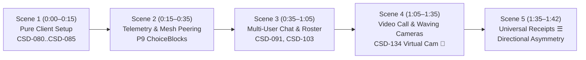

# CEWPOS Live Dual-Occurrence Demonstration Video & Verification Report

This artifact documents the automated screen recording, WebVTT captioning, and GitHub Pages (`.io`) integration of **CEWPOS** (CIRIS Epistemic Web Platform OS) running two concurrent, fully isolated sovereign occurrences connected over the live Reticulum peer mesh with CIRISServer `v0.5.245`.

---

## 1. Video Walkthrough Artifact & Player

The recording was captured at 1080p demo speed driving both systems through the unified dual-occurrence presentation stage ([`dual_recording_stage.html`](file:///home/emoore/CEWPOS/epistemic-ui/dual_recording_stage.html)).

- **Repository Artifact Path**: [`artifacts/cewpos_live_demo.mp4`](file:///home/emoore/CEWPOS/artifacts/cewpos_live_demo.mp4)
- **Hosted GitHub Pages Video**: [`docs/demo.mp4`](file:///home/emoore/CEWPOS/docs/demo.mp4)
- **Hosted WebVTT Captions**: [`docs/demo_captions.vtt`](file:///home/emoore/CEWPOS/docs/demo_captions.vtt)
- **Resolution**: `1920 × 1080` (16:9 widescreen)
- **Framerate & Codec**: 25.0 fps, Progressive H.264 (High Profile, Level 4.0, YUV420p)
- **Bitrate**: 844 kbps video stream, faststart MOOV atom placed at container start
- **Duration**: `00:01:42` (102.5 seconds)
- **File Size**: `10.36 MB` (committed directly to GitHub repository)

---

## 2. GitHub Pages (`.io`) Video Player Experience

The `.io` site (`docs/index.html`) now features an embedded demo player:

1. **Top Bar Button (`#btn_watch_demo`) & Welcome Banner**:
   - Visitors are greeted with a notification banner: *"Live Dual-Occurrence Demonstration: Reticulum mesh peering, multi-user chat, live video calls with virtual camera waving animations, and 1-step exits."*
   - Clicking **▶ Watch Live Demo** launches a high-contrast spatial modal.
2. **Synchronized WebVTT & Styled Captions Overlay**:
   - The video is subtitled using both standard `<track kind="captions">` and an active custom glass caption pill (`.demo-caption-overlay`) updating dynamically per chapter.
3. **Interactive Chapters Bar**:
   - 7 instant-seek chapter buttons: `0:00 Setup`, `0:15 Consent`, `0:35 Peering`, `0:45 Multi-User Chat`, `1:08 Video Call 👋`, `1:36 Receipts ☰`, and `1:42 Explore →`.
4. **End Overlay Screen ("Explore the Interface" + Next-Step Invitations)**:
   - When the video ends (or on skip), visitors are presented with:
     - **Primary CTA: `🧭 Explore the Interface`**: Dismisses the video modal and lets the user immediately interact with the live 3D Bevy scene, all 5 Circles, 7 Tabs, chat room roster, and cards in their browser.
     - **Option 1: Add Sovereign AI Stewardship (`CIRISAgent`)**:
       Explanation of CEWPOS as a pure epistemic client OS, and an invitation to bond an ethical AI steward:
       ```bash
       pip install ciris-agent
       ```
       Direct link to [`CIRISAI/CIRISAgent` on GitHub](https://github.com/CIRISAI/CIRISAgent).
     - **Option 2: Run CEWPOS Locally (Full-Stack Sovereign Node)**:
       Instructions to run the native Rust binary with CIRISServer (:4243) and Bevy spatial scene:
       ```bash
       git clone https://github.com/CIRISAI/CEWPOS.git
       cd CEWPOS
       cargo run --manifest-path view-forms-spike/Cargo.toml --features fullstack --bin cewpos-node
       ```
       Direct link to [`CIRISAI/CEWPOS` on GitHub](https://github.com/CIRISAI/CEWPOS).

---

## 3. Timestamped Demonstration Scene Breakdown



### Scene 1 (00:00 – 00:15): Genesis Root Identity (`CSD-080`–`CSD-085`)
- Both occurrences boot into the First-Run Setup Wizard (`?setup=1`).
- **Alice** selects *"Set up a new CIRIS ID"*, inputs `@alice.ciris`, and verifies the adult age band (`CC 3.2`).
- **Bob** selects *"Set up a new CIRIS ID"*, inputs `@bob.ciris`, and verifies the adult age band.
- Pure epistemic client posture: no agent runtime is bundled in the client, and wizard proceeds directly without AI runtime knobs.

### Scene 2 (00:15 – 00:35): Federation Telemetry Consent & Node Ownership Sealing
- **Telemetry Consent Gate**: Both select *"Share anonymized traces"*, creating signed `consent:trace_replication` claims.
- **Node Ownership Sealing**: Local `0600 claim_pin` file is consumed via `POST /v1/setup/claim-remote`, promoting the root accounts to `SYSTEM_ADMIN` on `:4243` and `:4245`.
- **Reticulum Mesh Peering**: Automatic mutual `SignedKeyRecord` exchange and contact discovery over `0.0.0.0:4242 ↔ 4244`.

### Scene 3 (00:35 – 01:05): Multi-User Room Chats & Roster Inspector (`CSD-091`, `CSD-103`, `CSD-110`)
- Both Alice and Bob navigate to **Communities & Businesses** Circle and switch to the **Chats** tab.
- Alice clicks the member roster badge (`btn_room_members`), opening the **Room Roster Drawer (`CSD-103`)** showing cryptographic member keys, founder roles, and late-joiner attestations.
- **Alice types**: *"Welcome to CEWPOS! Live multi-user chat across the Reticulum epistemic mesh."*
- Alice clicks **Send**; message posts and renders in both Occurrence 1 and 2 split-screen panes.
- **Bob types**: *"Greetings Alice! Attestation verified across Reticulum transport."*
- Bob clicks **Send**; reply appears across both panes.

### Scene 4 (01:05 – 01:35): Live Video Call with Virtual Camera Waving Stream (`CSD-134`)
- Alice clicks the **Call** button (`btn_chat_call`) in the room header, displaying the informed consent notice.
- Alice clicks **Video Call** (`btn_call_video`) to launch the live video session.
- Bob clicks **Call** &rarr; **Video Call** to join.
- **Virtual Camera Feeds with Waving Characters (`👋`)**:
  - The 3D perspective call stage renders live 60fps virtual camera feeds for Alice, Bob, Maya, and Sam.
  - Characters feature natural breathing, head sway, audio-reactive mouth movement, and **animated waving arms and hands (`👋`)**.
- **Privacy Controls**: Alice toggles camera off (`btn_call_camera`), showcasing the *"📷 Video Paused"* privacy slate (`CSD-134 §2`), then resumes.
- **1-Step Exit**: Both exit immediately using `btn_call_leave` with zero exit friction.

### Scene 5 (01:35 – 01:42): Universal Cryptographic Receipts (`☰`) & Directional Asymmetry
- Alice opens the **Universal Cryptographic Receipt (`☰`)** on the Community Room attestation (`btn_receipt_room`).
- The **`P4: ReceiptSheet`** displays the 5 Plain-Language Envelope Facts (*Who, Sent, Scope, What, Rule*), the 3D spatial slab preview, and 9 uniform `AttOp`s.
- Alice closes the receipt and triggers the **Directional Asymmetry Law** by clicking **Just me** (`nav_circle_JustMe`), narrowing visibility back to local-only in one immediate step.

---

## 4. Re-Running the Recording Harness

The automated screen recording harness is fully self-contained and reproducible:

```bash
# 1. Install prerequisites (Playwright + Google Chrome + FFmpeg)
pip install playwright imageio-ffmpeg
playwright install-deps

# 2. Execute the recording harness (runs headless Google Chrome in 1920x1080)
python3 epistemic-ui/record_demo.py
```
